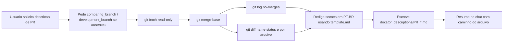

# PR Description Generator

Produce a Portuguese PR description markdown file that explains the work done
on `origin/<development_branch>` in relation to `origin/<comparing_branch>`.
Write the file to `docs/pr_descriptions/`. Do **nothing else** on the git
repository.

## Inputs

- `comparing_branch` — base branch of the PR (e.g. `homolog`, `main`, `develop`).
- `development_branch` — source branch containing the new work.
- `sa_correspondente` — SA associated with the PR title, inferred from
  `development_branch` when possible (e.g. `sa-1758`, `SA_1758`, `SA1758`
  become `SA-1758`).

If either input is missing, ask the user with `AskQuestion` before continuing.
Do not guess. Do not assume the current checked-out branch is one of them.
If `sa_correspondente` cannot be inferred from `development_branch`, ask the
user for the corresponding SA before drafting the title. Do not invent a SA.

Both branches are resolved as remote refs: `origin/<comparing_branch>` and
`origin/<development_branch>`.
If you can't fetch the branches due to lack of access permissions, ask if the 
local reffered branches are up-to-date and use them.

## Guardrails (read-only)

These rules are non-negotiable.

**Allowed git commands only:**

- `git rev-parse` (to validate refs exist)
- `git fetch origin <comparing_branch> <development_branch>` (fetch refs only;
  no tracking updates, no pruning)
- `git merge-base origin/<comparing_branch> origin/<development_branch>`
- `git log --no-merges --pretty=...` on the range
- `git diff --name-status <merge_base>...origin/<development_branch>`
- `git diff <merge_base>...origin/<development_branch> -- <path>`
- `git show <sha> -- <path>` (read-only inspection of a commit)
- `git ls-tree origin/<development_branch> -- <path>` (inspect files at ref)

**Forbidden:**

- `checkout`, `switch`, `commit`, `push`, `pull`, `merge`, `rebase`, `cherry-pick`,
  `reset`, `revert`, `stash`, `add`, `rm`, `mv`, `tag`, `branch` (create/delete/rename),
  `config`, `remote set-*`, any hook invocation, any `--amend`.
- Any `--stat`, `--shortstat`, `--numstat`, `--dirstat` or other line-count flags
  in the final output. You may read them for internal reasoning, but never
  include numeric churn data in the generated markdown.
- Writing, editing, deleting, or moving any file outside
  `docs/pr_descriptions/`. The only file this skill creates is the PR
  description markdown.
- Running the project (no `uvicorn`, no `pytest`, no `docker`).

If any step would require a forbidden command, stop and report the limitation
to the user instead.

## Workflow checklist

Track progress with `TodoWrite`:

```
PR Description Progress:
- [ ] Step 1: Validate inputs and repo
- [ ] Step 2: Fetch remote refs (read-only)
- [ ] Step 3: Resolve merge-base
- [ ] Step 4: Collect commit list
- [ ] Step 5: Collect changed-file list (name + status only)
- [ ] Step 6: Inspect per-file diffs for intent
- [ ] Step 7: Cluster changes into themes
- [ ] Step 8: Draft the description in Portuguese
- [ ] Step 9: Ensure docs/pr_descriptions/ exists and write the file
- [ ] Step 10: Summarize in chat with output path
```

### Step 1: Validate inputs and repo

- Confirm both `comparing_branch` and `development_branch` are provided.
- Infer `sa_correspondente` from `development_branch` when it contains a clear
  SA token such as `sa-1758`, `SA_1758`, or `SA1758`; normalize it as `SA-1758`.
- If no clear SA token exists in `development_branch`, ask the user for the
  corresponding SA before continuing to the draft. Do not guess from commits or
  changed files.
- Run `git rev-parse --is-inside-work-tree` to confirm the workspace is a repo.
- If not a repo, stop and inform the user.

### Step 2: Fetch remote refs

Run exactly:

```bash
git fetch origin <comparing_branch> <development_branch>
```

If the fetch fails (branch missing, no remote access), stop and report. Do not
attempt to create or push anything.

### Step 3: Resolve merge-base

```bash
git merge-base origin/<comparing_branch> origin/<development_branch>
```

Store the resulting SHA as `<merge_base>`. All subsequent diffs use the
three-dot range `<merge_base>...origin/<development_branch>` so only the work
actually added on the development branch is analyzed (not churn introduced on
the base after the branch point).

### Step 4: Collect commit list (internal reasoning only)

```bash
git log --no-merges \
  --pretty='%h%x09%an%x09%s' \
  <merge_base>..origin/<development_branch>
```

Use this list **only to understand the intent** of the work. Do **not** emit
a "Commits incluídos" section or any other list of commits, SHAs, or authors
in the final markdown — the output has a fixed set of sections (see
[Output sections](#output-sections)).

### Step 5: Collect changed-file list (internal reasoning only)

```bash
git diff --name-status <merge_base>...origin/<development_branch>
```

Capture only the status letter (A/M/D/R/C) and path, and use the result
**only to drive clustering and per-file inspection**. Do **not** emit a
"Arquivos principais tocados" section or any file list in the final markdown.
Do **not** use `--numstat`, `--stat`, or `--shortstat` — even for "internal
reasoning" — because the numbers tend to leak into the summary.

### Step 6: Inspect per-file diffs for intent

For each non-trivial path (Python modules, prompts, routers, infra config),
run:

```bash
git diff <merge_base>...origin/<development_branch> -- <path>
```

For large or auto-generated files (lockfiles, snapshots, fixtures), skim only
the header to confirm the nature of the change and move on. When the diff
alone is not enough to understand intent, read the file at the development
ref:

```bash
git show origin/<development_branch>:<path>
```

### Step 7: Cluster changes into themes

Group the changed files into coherent themes such as:

- por módulo (`app/modules/ocr/...`, `app/modules/sam_ai/...`)
- por feature (novo agente, novo endpoint)
- por correção (bugfix, ajuste de prompt, limpeza de resposta)
- por infraestrutura/config (Dockerfile, `requirements.txt`, CI)
- por documentação

Each theme becomes a subsection under "O que foi feito".

### Step 8: Draft the description in Portuguese

Use the template at [template.md](template.md) as the structural reference.
The output has a **fixed set of sections** (see [Output sections](#output-sections))
— do not add, reorder, or rename them.

Rules for the draft:

- **Idioma:** português do Brasil (pt-BR) em todo o arquivo.
- **Título sugerido:** use exatamente o formato
  `**Título sugerido do PR:** \`[HML][<SA correspondente>] <prefixo (FEAT|FIX|REFACTOR|CHORE|DOCS)>: título em pt-BR\``.
  O prefixo deve ficar em maiúsculas e deve ser escolhido a partir da natureza
  da mudança: `FEAT`, `FIX`, `REFACTOR`, `CHORE` ou `DOCS`.
- **Sem métricas numéricas:** nada de "+X linhas", "-Y linhas", "N arquivos",
  "N commits", percentuais de cobertura ou churn.
- **Foco no "porquê" e no impacto**, não no volume.
- **"Melhorias no projeto" é obrigatória:** liste melhorias qualitativas
  (robustez, observabilidade, segurança, clareza de API, DX, manutenibilidade,
  qualidade de prompts, precisão de extração, etc.). Nunca quantifique com
  números de linhas.
- **Mermaid opcional:** inclua a seção "Fluxo" apenas se a PR introduz ou
  altera um fluxo relevante; caso contrário, remova a seção. Siga as regras
  de sintaxe mermaid do projeto (sem espaços em IDs, use `subgraph id [Label]`,
  etc.).
- **"Riscos e pontos de atenção":** apenas quando houver breaking change,
  mudança de contrato de API, migração de dados ou dependência externa; caso
  contrário, remova a seção.
- **Não inclua** seções fora das listadas em [Output sections](#output-sections)
  (sem "Branches de referência", "Commits incluídos", "Como validar",
  "Arquivos principais tocados" ou quaisquer tabelas com SHAs e caminhos).

### Step 9: Write the file

1. Ensure `docs/pr_descriptions/` exists; create it if missing. This is the
   only directory the skill may create.
2. Compute the output filename (see [Filename convention](#filename-convention)).
3. Write the markdown file with `Write`. Never overwrite an existing file —
   if the target filename already exists, append `_HHMMSS` (current local
   time) before the `.md` extension and use that instead.

### Step 10: Summarize in chat

Reply with:

1. The output file path (as a markdown link).
2. The PR title suggestion.
3. A 3-5 bullet summary of the main themes covered (no numbers).

Do not paste the full file content back into the chat.

## Filename convention

```
PR_<dev-slug>_sobre_<base-slug>_YYYY-MM-DD.md
```

Where:

- `<dev-slug>` = `development_branch` lowercased, with `/`, `_`, and
  whitespace replaced by `-`, and any other non-alphanumeric/hyphen character
  stripped.
- `<base-slug>` = same transformation applied to `comparing_branch`.
- `YYYY-MM-DD` = the current local date.

Examples:

- `development_branch = feat/sa-1758-itau-buyer-form-agent`,
  `comparing_branch = homolog`, date `2026-04-17`
  → `PR_feat-sa-1758-itau-buyer-form-agent_sobre_homolog_2026-04-17.md`
- `development_branch = fix/itau-real-estate-validation-adjustments`,
  `comparing_branch = main`, date `2026-04-17`
  → `PR_fix-itau-real-estate-validation-adjustments_sobre_main_2026-04-17.md`

If that path already exists, use
`PR_<dev-slug>_sobre_<base-slug>_YYYY-MM-DD_HHMMSS.md` instead. Never
overwrite.

## Output sections

The final markdown contains **only** these sections, in this exact order:

1. **Título sugerido do PR** — a single bold line at the top of the file:
   `**Título sugerido do PR:** \`[HML][<SA correspondente>]<prefixo (FEAT|FIX|REFACTOR|CHORE|DOCS)>: título em pt-BR\``.
2. **Contexto** (`## Contexto`) — 1-3 parágrafos explicando o "porquê".
3. **O que foi feito** (`## O que foi feito`) — subdividido por módulo / tema
   em subseções `### 1.`, `### 2.`, etc.
4. **Melhorias no projeto** (`## Melhorias no projeto`) — lista qualitativa,
   sem métricas. **Obrigatória.**
5. **Fluxo** (`## Fluxo (opcional)`) — mermaid opcional; remover a seção
   inteira quando não houver diagrama.
6. **Riscos e pontos de atenção** (`## Riscos e pontos de atenção`) — remover
   a seção inteira quando não houver risco relevante.

Nada além dessas seções pode ser incluído. Em particular: **não** adicionar
"Branches de referência", "Commits incluídos", "Como validar", "Arquivos
principais tocados" ou qualquer tabela com SHAs, autores ou caminhos de
arquivos.

## Content rules (recap)

The final markdown must:

- Be written in Portuguese (pt-BR).
- Contain exactly the sections listed in [Output sections](#output-sections),
  in that order.
- Include "Melhorias no projeto" listing qualitative project improvements.
- Exclude lines-of-code metrics, diff stats, churn numbers, percentages of
  change, and any count of commits or files.
- Use backticks for file paths, class names, function names, module names.
- Be self-contained (no links to internal trackers unless present in commit
  messages).

## Trigger phrases

This skill activates when the user says any of:

- "escreva a descrição do PR"
- "gerar descrição de PR"
- "descrição de PR comparando <x> e <y>"
- "descricao de PR comparando <x> e <y>"
- "PR description comparing branches"
- "write a PR description comparing <x> and <y>"
- "compare origin/<x> com origin/<y> e descreva"
- "descreva o que foi feito em <dev> em relação a <base>"

## Example invocation flow



## Additional resources

- Full Portuguese template: [template.md](template.md)
