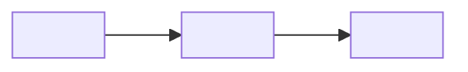

<!--
  Template de descrição de PR (pt-BR).

  REGRAS OBRIGATÓRIAS ao preencher este template:
  - NÃO incluir métricas de linhas de código (nada de "+X / -Y", churn,
    contagem de arquivos, contagem de commits, percentuais de cobertura).
  - NÃO alterar nenhuma branch, índice, working tree ou histórico.
  - Escrever 100% em português (pt-BR).
  - Preservar a seção "Melhorias" — ela é obrigatória.
  - A descrição contém SOMENTE as seções abaixo, nesta ordem. Não adicione
    outras seções (sem "Branches de referência", "Commits incluídos",
    "Como validar", "Arquivos principais tocados", etc.).
  - Remover as seções opcionais não aplicáveis antes de salvar:
    - "Fluxo": remover quando não há diagrama.
    - "Riscos e pontos de atenção": remover quando não há risco relevante.
  - Substituir todos os placeholders <...> por conteúdo real.
  - Usar o formato de título:
    **Título sugerido do PR:** `[HML][<SA correspondente>]<prefixo (FEAT|FIX|REFACTOR|CHORE|DOCS)>: título em pt-BR`
  - Se a SA correspondente não puder ser inferida pela branch de desenvolvimento,
    perguntar ao usuário antes de preencher o título.
-->

**Título sugerido do PR:** `[HML][<SA correspondente>] <prefixo (FEAT|FIX|REFACTOR|CHORE|DOCS)>: título em pt-BR`

## Contexto

<Resumo do problema ou da demanda que motivou a PR, no que o usuário/negócio
ganha com a mudança e em qual parte do sistema ela atua. 1-3 parágrafos.>

## O que foi feito

<!-- Agrupe as alterações por tema/módulo. Use subseções numeradas.
     Foque no que mudou do ponto de vista do comportamento e da arquitetura,
     não no volume de código. -->

### 1. <Tema ou módulo A>

- <Alteração concreta, citando classes/arquivos/funções com crase.>
- <Alteração concreta.>

### 2. <Tema ou módulo B>

- <Alteração concreta.>
- <Alteração concreta.>

### 3. <Tema ou módulo C>

- <Alteração concreta.>

## Melhorias no projeto

<!-- Seção OBRIGATÓRIA. Liste ganhos qualitativos para o projeto.
     Nunca quantifique com contagem de linhas. -->

- **<Categoria, ex.: Robustez>:** <melhoria concreta e seu impacto.>
- **<Categoria, ex.: Observabilidade>:** <melhoria concreta e seu impacto.>
- **<Categoria, ex.: Segurança>:** <melhoria concreta e seu impacto.>
- **<Categoria, ex.: DX / Manutenibilidade>:** <melhoria concreta e seu impacto.>
- **<Categoria, ex.: Qualidade de IA / prompts>:** <melhoria concreta e seu impacto.>

## Fluxo (opcional)

<!-- Inclua apenas se a PR introduz ou altera um fluxo de dados/execução.
     Caso contrário, remova esta seção inteira. Siga as regras de mermaid do
     projeto: sem espaços em IDs, use aspas em labels com parênteses, evite
     palavras reservadas como `end`. -->

## Riscos e pontos de atenção

<!-- Inclua apenas quando houver breaking change, mudança de contrato de API,
     migração de dados, nova dependência externa ou efeito colateral
     relevante. Caso contrário, remova esta seção inteira. -->

- **<Risco ou ponto de atenção>:** <descrição e mitigação sugerida.>

---

Referente à task: